<!--
  Stefan Butnaru (stefandsl): system administrator at Helinext, senior IoT engineer at VoidExploit. Venice.
  AI agents, security tooling and courses. VoidExploit / Helinext.
  Website: https://www.stefandsl.com/
  LinkedIn: https://www.linkedin.com/in/stefan-butnaru/
  TODO: replace the remaining links marked TODO below.
-->

<a name="hero"><picture><source media="(prefers-color-scheme: light)" srcset="./assets/light/hero.svg" /></picture></a>

 
<picture><source media="(prefers-color-scheme: light)" srcset="./assets/light/granted.svg" /></picture>

**Console**

- **Train**: take the <a href="#">VoidExploit Academy</a> course <!-- TODO: academy URL -->
- **Deploy**: try <a href="#">VoidExploit 2.0</a> or <a href="https://github.com/stefandsl/bellerophon-go">Bellerophon</a> <!-- TODO: VoidExploit URL -->
- **Travel**: <a href="https://www.stefandsl.com/">stefandsl.com</a>, <a href="https://www.helinext.it">helinext.it</a> or <a href="https://www.linkedin.com/in/stefan-butnaru/">LinkedIn</a>
- **Connect**: got a project? <a href="mailto:stefandsl@outlook.com">write me</a>
- **Signal**: star a repo you use, it keeps the void lit

<a href="https://www.voidexploit.com/"><picture><source media="(prefers-color-scheme: light)" srcset="./assets/light/btn-academy.svg" /></picture></a>

  <b>Stefan Butnaru</b>: system administrator at <b>Helinext</b> and senior IoT engineer at <b>VoidExploit</b>, based in Venice. 
  15 years in telecom and IT, now building <b>AI agents</b>, security tooling and AI courses. 
  <i>stefandsl: your digital subscriber line into the future.</i>

<a name="divider"><picture><source media="(prefers-color-scheme: light)" srcset="./assets/light/divider.svg" /></picture></a>

 
<a href="#"><picture><source media="(prefers-color-scheme: light)" srcset="./assets/light/recruit.svg" /></picture></a>

**Learn to steer AI.** VoidExploit Academy is an Italian-first, hands-on AI course: interactive decks, workshops and labs, with English, Romanian and Russian versions.

<a href="https://www.voidexploit.com/"><picture><source media="(prefers-color-scheme: light)" srcset="./assets/light/btn-academy.svg" /></picture></a>

## <a name="h-about"><picture><source media="(prefers-color-scheme: light)" srcset="./assets/light/h-about.svg" /></picture></a> About Me

I'm Stefan, a **telecom engineer and system administrator** based in **Venice**, with more than ten years in telecommunications. Networking is the part I love most, especially network aggregators and load balancers.

Since September 2025 I've been a **system administrator at Helinext**: network services, systems management, network assessments and IT asset reporting. Before that I spent five years as an **ISP systems technician at Ki-Net**, installing and maintaining network equipment for TIM, Fastweb, Wind, Irideos, Vodafone and Clouditalia, mostly for business and executive customers and special projects. I've worked hands-on with MikroTik, Huawei, ZTE, UniFi, FRITZ!, ADB and Aethra gear.

Since 2012 I've also run **VoidExploit**, my own studio, as a freelance senior IoT engineer. That's where the AI work lives: systems that turn noise into intelligence, such as vulnerability reports people actually read, documents scrubbed of personal data before they reach an LLM, and agents that handle the repetitive half of security and compliance work. **VoidExploit Academy** is my Italian-first AI course, with interactive lessons in four languages.

I studied Asian and Mediterranean African languages and cultures (Japanese) at **Ca' Foscari University of Venice**, after a year in Texas as a **FLEX** exchange student. Along the way I've worked on special projects such as the first hackathon in Venice. Next on my list are **CCNP Enterprise, CCIE Infrastructure and Wireless, and Juniper** certifications, alongside my home lab.

**Open to new projects.** If you have something in mind, [write me](mailto:stefandsl@outlook.com).

<table>
  <tr>
    <td><b>Focus</b></td>
    <td>Networking · Systems administration · Troubleshooting · IoT · Automation</td>
  </tr>
  <tr>
    <td><b>Exploring</b></td>
    <td>AI agents · Neural networks · Robotics · Quantum networking · Ethical dev</td>
  </tr>
  <tr>
    <td><b>Languages</b></td>
    <td>Romanian (native) · Italian · English · Russian · Japanese (basic)</td>
  </tr>
</table>

## <a name="h-quest"><picture><source media="(prefers-color-scheme: light)" srcset="./assets/light/h-quest.svg" /></picture></a> Quest Log

<picture><source media="(prefers-color-scheme: light)" srcset="./assets/light/timeline.svg" /></picture>

<b>Full log: roles and certifications</b>

 

| When | Role | Where |
|---|---|---|
| Sep 2025 – now | System Administrator | Helinext S.r.l., Venice (hybrid) |
| 2012 – now | Senior IoT Engineer | VoidExploit (freelance) |
| Jun 2020 – Aug 2025 | ISP Systems Technician | Ki-Net S.r.l. |
| Apr – Sep 2019 | IT Manager | a&o Hostels, Venice |
| 2018 – 2019 | Sales Officer | MediaWorld, Venice |
| 2018 | Promoter / Merchandiser | Acer, Italy |
| May 2011 – Jan 2012 | Telecom Technician (internship) | Moldtelecom, Ungheni, Moldova |
| Sep 2010 – May 2011 | IT Lead (apprenticeship) | Temple Library, Texas, USA |

**Certifications**

- **Omada Certified Network Administrator (OCNA) – Wireless**, TP-Link · 2026
- **Syneto Certified Professional (SCP)**, Syneto · 2025
- **Generative AI track** (6 courses: Intro to AI, Ethics in the Age of Generative AI, Microsoft 365 Copilot and more), LinkedIn Learning · 2024
- **The President's Volunteer Service Award** · 2011

## <a name="h-projects"><picture><source media="(prefers-color-scheme: light)" srcset="./assets/light/h-projects.svg" /></picture></a> Projects: Choose Your Module

<table>
  <tr>
    <td width="50%" valign="top">
      <a href="#"><picture><source media="(prefers-color-scheme: light)" srcset="./assets/light/card-voidexploit.svg" /></picture></a>
      
<b>VoidExploit 2.0</b>: OpenVAS imports, OCR, PII detection, GDPR and NIS 2 compliance, white-label reports.

    </td>
    <td width="50%" valign="top">
      <a href="#"><picture><source media="(prefers-color-scheme: light)" srcset="./assets/light/card-academy.svg" /></picture></a>
      
<b>VoidExploit Academy</b>: 116 interactive lessons, 11 modules, 53+ hours in IT / EN / RO / RU.

    </td>
  </tr>
  <tr>
    <td width="50%" valign="top">
      <a href="https://github.com/stefandsl/bellerophon-go"><picture><source media="(prefers-color-scheme: light)" srcset="./assets/light/card-bellerophon.svg" /></picture></a>
      
<b><a href="https://github.com/stefandsl/bellerophon-go">Bellerophon</a></b>: single-binary Go voice stack on sipgo and pion/rtp.

    </td>
    <td width="50%" valign="top">
      <a href="#"><picture><source media="(prefers-color-scheme: light)" srcset="./assets/light/card-pista-ai.svg" /></picture></a>
      
<b>Pista AI</b>: curated catalog of AI tools and prompts, each verified at the source.

    </td>
  </tr>
</table>

<picture><source media="(prefers-color-scheme: light)" srcset="./assets/light/vault.svg" /></picture>

 
<picture><source media="(prefers-color-scheme: light)" srcset="./assets/light/vault-open.svg" /></picture>

<!-- TODO: edit this list -->
- **[bellerophon-install](https://github.com/stefandsl/bellerophon-install)**: one-line installer for the Bellerophon voice stack.
- **[Cyberscraper](https://cyberscraper.netlify.app/)**: web scraper, live on Netlify.
- **[MellodifAI-web-app](https://github.com/stefandsl/MellodifAI-web-app)**: MellodifAI web app.
- **LinguaVault**: language-learning vault. <!-- TODO: link + description -->
- **HELINEXT dossier generator**: branded IT asset dossiers from scan data. <!-- TODO: link or remove -->

## <a name="h-boss"><picture><source media="(prefers-color-scheme: light)" srcset="./assets/light/h-boss.svg" /></picture></a> Boss Fight

<picture><source media="(prefers-color-scheme: light)" srcset="./assets/light/gate.svg" /></picture>

 
<picture><source media="(prefers-color-scheme: light)" srcset="./assets/light/boss.svg" /></picture>

**The 40-Hour Manual Audit.** Weakness: agents that read, redact and report for you. VoidExploit imports the scan, strips the personal data, maps findings to GDPR and NIS 2, and ships a branded report.

## <a name="h-faq"><picture><source media="(prefers-color-scheme: light)" srcset="./assets/light/h-faq.svg" /></picture></a> FAQ

<b>Who is stefandsl?</b>

 
Stefan Butnaru, a telecom engineer and system administrator at <a href="https://www.helinext.it">Helinext</a> in Venice, and a senior IoT engineer at VoidExploit. He works on networking, AI agents, security tooling and AI education. Creator of VoidExploit and VoidExploit Academy. Website: <a href="https://www.stefandsl.com/">stefandsl.com</a>.

<b>What is VoidExploit?</b>

 
A platform that turns vulnerability scans and documents into actionable intelligence: OpenVAS import, OCR, translation, PII detection, compliance checks and branded reports.

<b>What is VoidExploit Academy?</b>

 
An Italian-first AI course: 116 interactive presentations across 11 modules, plus workshops, with English, Romanian and Russian versions.

## <a name="h-stack"><picture><source media="(prefers-color-scheme: light)" srcset="./assets/light/h-stack.svg" /></picture></a> Tech Stack

<picture><source media="(prefers-color-scheme: light)" srcset="./assets/light/stack.svg" /></picture>

## <a name="h-connect"><picture><source media="(prefers-color-scheme: light)" srcset="./assets/light/h-connect.svg" /></picture></a> Connect

  <a href="https://www.stefandsl.com/"><picture><source media="(prefers-color-scheme: light)" srcset="./assets/light/btn-site.svg" /></picture></a>
  <a href="https://www.helinext.it"><picture><source media="(prefers-color-scheme: light)" srcset="./assets/light/btn-website.svg" /></picture></a>
  <a href="https://www.linkedin.com/in/stefan-butnaru/"><picture><source media="(prefers-color-scheme: light)" srcset="./assets/light/btn-linkedin.svg" /></picture></a>
  <a href="mailto:stefandsl@outlook.com"><picture><source media="(prefers-color-scheme: light)" srcset="./assets/light/btn-email.svg" /></picture></a>
  <a href="https://www.voidexploit.com/"><picture><source media="(prefers-color-scheme: light)" srcset="./assets/light/btn-academy.svg" /></picture></a>

